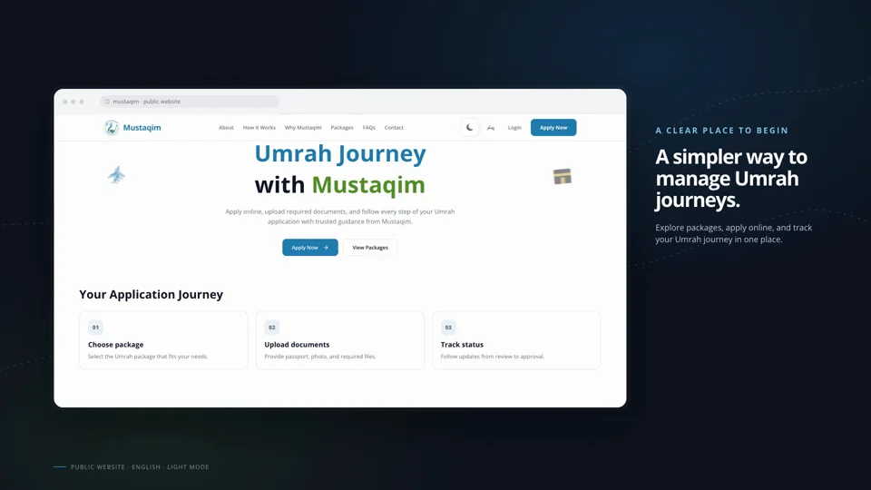
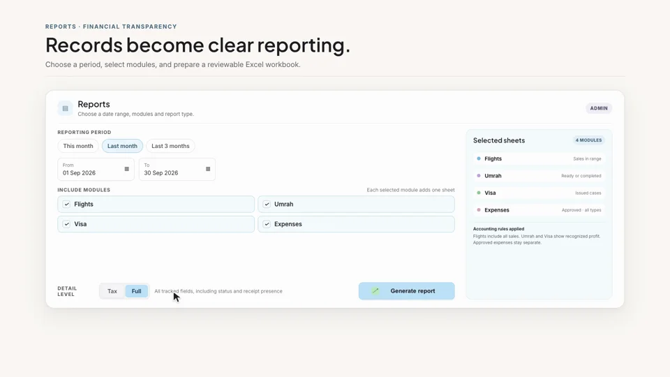

# Abdul Rahman Dad Khan

Computer Engineer and software developer in Kabul, Afghanistan. My work focuses on designing and developing software that helps businesses simplify their daily operations. I’m exploring AI and automation.

## Selected work

### Mustaqim Umrah Management

A completed Umrah management web application that supports online applications, document submission, and application progress tracking, with English and Pashto RTL interfaces. The application is not publicly deployed, and its source remains private.

[LinkedIn video showcase](https://www.linkedin.com/feed/update/urn:li:activity:7518969785573863424/) · [X thread](https://x.com/xandros_xx/status/2115091661302923403)

### Mustaqim Finance App

An internal finance application for Mustaqim that organizes service records, expenses, balances, and reporting. It is deployed for internal agency use and is not publicly accessible; its source remains private. The image below uses synthetic demonstration data.

[LinkedIn video showcase](https://www.linkedin.com/feed/update/urn:li:activity:7520808693136023552/) · [X thread](https://x.com/xandros_xx/status/2115093743116095670)

## Technologies

Next.js · React · TypeScript · Tailwind CSS · Supabase · PostgreSQL

## Connect

[LinkedIn](https://www.linkedin.com/in/abdulrahmandadkhan/) · [X](https://x.com/xandros_xx)
